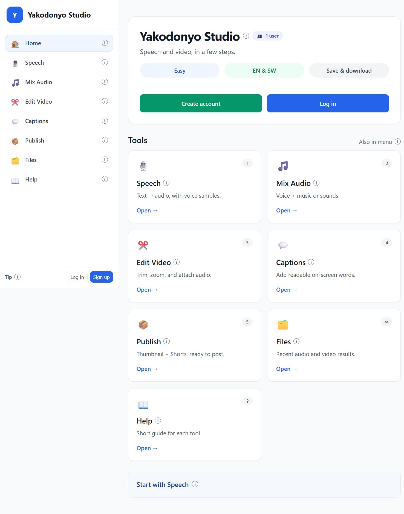

# Yakodonyo Studio

Clone voices and produce short-form video in **English** and **Swahili** from one
browser app: generate speech, mix audio, trim and zoom video, burn karaoke
captions, and publish a YouTube-ready package — with cloud and local TTS engines,
Cloudflare R2 storage, and a FastAPI backend.



## At a glance

| | |
|---|---|
| **Frontend** | Next.js 14 · TypeScript · React 18 · Tailwind CSS (`frontend/`) |
| **Backend** | FastAPI · Python 3.11 · SQLite accounts (`backend/`) |
| **Storage** | Cloudflare R2 via presigned URLs, with local `/static/{outputs,audio,video,thumbs}` fallback |
| **TTS engines** | Azure AI Speech, ElevenLabs, Kyutai Pocket TTS, AfriSpeech Pocket, Msingi/XTTS-v2, Meta MMS |
| **Accounts** | Email/password signup & login, signed bearer tokens, protected feature pages, profile and password settings |
| **Hosting** | Vercel (frontend) + Railway ~$5 Pro (backend) + R2 free tier |
| **CI** | Backend compile + pytest, frontend lint + Vitest + production build on every push/PR |

## Features

| Tool | Route | What it does |
|---|---|---|
| Text-to-Speech | `/text-to-speech` | Clean, noise-reduced voice cloning (EN/SW), previews, variations, export |
| Mix Audio | `/speech-and-background` | Three-layer mix (voice + ambient + music) with ducking and mastering |
| Edit Video | `/trimming-and-zooming` | Trim warp tails, gentle zoom, stitch clips, mux unified audio |
| Captions | `/animated-captions` | Word-by-word karaoke captions, 9:16/1:1/16:9 safe zones, burned in one FFmpeg pass |
| Publish Package | `/publish-package` | Auto-designed thumbnail + three 9:16 Shorts → five ready-to-post files |
| Profile | `/profile` | View email, add optional name/phone/avatar, change password |
| Help | `/instruction-manual` | Public, no account required |

Public pages (`/`, `/instruction-manual`, `/login`, `/signup`, `/reset-password`)
can be browsed without an account; all creation tools require sign-in. The home
card also shows a live count of registered accounts (aggregate only).

The full engine comparison and Swahili delivery notes live in
[docs/ENGINES.md](docs/ENGINES.md).

## Architecture

```text
 Browser (Next.js / TypeScript)
   ├── public pages + RequireAuth-gated tools
   ├── direct presigned uploads to Cloudflare R2
   └── REST calls ──► Railway (FastAPI / Python)
                        ├── auth: PBKDF2 users, HMAC bearer tokens, SQLite
                        ├── engines: Azure / ElevenLabs / local TTS models
                        ├── processors: audio, video, captions, packaging
                        └── storage: R2 client + local /static fallback
```

| Directory | Responsibility |
|---|---|
| `frontend/src/app` | App-router pages and API route `/api/upload-url` |
| `frontend/src/components` | `AuthProvider`, `RequireAuth`, sidebar, shared UI |
| `frontend/src/lib` | API client, token storage, types |
| `backend/app/routers` | HTTP endpoints (`auth`, `synthesize`, `audio`, `video`, `captions`, `packaging`, …) |
| `backend/app/engines` | TTS provider adapters with a common base class |
| `backend/app/services` | Model manager, audio/video/caption processors, user store, storage |
| `backend/app/data` | Swahili normalization data |
| `scripts` | Dev-server watchdog |
| `docs` | Engine reference and screenshots |

Request flow: the browser uploads reference media straight to R2, sends text and
object keys to the backend, and polls/receives output URLs. Without R2
credentials, uploads use `PUT /api/v1/local-upload/{key}` and outputs are served
from the backend's output-only `/static/{outputs,audio,video,thumbs}` mounts.

## Prerequisites

- **Node.js 18+** and npm (frontend)
- **Python 3.11** (backend; Coqui/XTTS needs <3.12)
- **FFmpeg** with `libx264`, `aac`, `libmp3lame`, `libass` and a DejaVu/Liberation
  font for captions and thumbnails
- **Cloudflare R2** bucket (optional locally; required in production)
- **Hugging Face token** with access to gated Kyutai weights (local cloning engines)
- Optional cloud keys: Azure Speech, ElevenLabs
- Optional hosting: Railway and Vercel accounts

## Quick start (local)

```bash
git clone https://github.com/casuya-code/fuzzy-carnival.git
cd fuzzy-carnival

# Backend — terminal 1
cd backend
python -m venv .venv
# Windows: .venv\Scripts\activate
source .venv/bin/activate
pip install -r requirements.txt
cp .env.example .env          # fill in the values you need
python -m uvicorn app.main:app --reload --port 8000
```

```bash
# Frontend — terminal 2
cd frontend
npm ci
cp .env.local.example .env.local   # set NEXT_PUBLIC_RAILWAY_API_URL
npm run dev
```

Open <http://localhost:3000> and <http://127.0.0.1:8000/health>. Create an
account at `/signup`, then pick a tool from the sidebar. On Windows you can keep
both servers alive with the watchdog (see [Development](#development)).

## Commands

| Task | Command | Directory |
|---|---|---|
| Run API | `python -m uvicorn app.main:app --reload --port 8000` | `backend` |
| Compile backend | `python -m compileall app tests` | `backend` |
| Backend tests | `python -m pytest -q` | `backend` |
| Run frontend | `npm run dev` | `frontend` |
| Lint frontend | `npm run lint -- --no-cache` | `frontend` |
| Frontend tests | `npm test` | `frontend` |
| Production build | `npm run build` | `frontend` |
| Serve production build | `npm run start` | `frontend` |
| Dev watchdog (Windows) | `powershell -NoProfile -ExecutionPolicy Bypass -File scripts\dev-watch.ps1 -Force` | repo root |
| Watchdog status | `... -File scripts\dev-watch.ps1 -Status` | repo root |

## Configuration

Copy the example files and fill only what you need:
[`backend/.env.example`](backend/.env.example) and
[`frontend/.env.local.example`](frontend/.env.local.example). Never commit the
copies — `.gitignore` excludes them.

### Backend

| Group | Variables | Purpose |
|---|---|---|
| Auth | `API_KEY`, `REQUIRE_AUTH`, `AUTH_SECRET`, `AUTH_TOKEN_TTL_HOURS`, `APP_DB_PATH` | API key gate, signed user tokens, SQLite account DB location |
| Auth extras | `EXPOSE_RESET_TOKENS`, `EXPOSE_HEALTH_DETAILS`, `SMTP_*` | Password resets, health detail visibility |
| CORS | `ALLOWED_ORIGINS`, `CORS_ORIGIN_REGEX` | Explicit browser origins; localhost-only by default |
| Uploads | `MAX_UPLOAD_MB`, `SERVE_STATIC`, `PUBLIC_BASE_URL`, `ALLOW_LOCAL_MEDIA_FALLBACK`, `UPLOAD_SCAN_URL` | Size limits, output URLs, optional AV scan webhook |
| R2 | `R2_ACCOUNT_ID`, `R2_ACCESS_KEY_ID`, `R2_SECRET_ACCESS_KEY`, `R2_BUCKET_NAME`, `R2_PUBLIC_URL` | Object storage; omit for local fallback |
| Models | `HF_TOKEN`, `HF_HUB_CACHE`, `ENABLE_*`, `MMS_MODEL_ID`, `MSINGI_CHECKPOINT_PATH` | Gated weights, engine flags, checkpoints |
| Cloud TTS | `AZURE_SPEECH_*`, `ELEVENLABS_*` | Provider credentials and voice/model defaults |
| Limits | `REDIS_URL`, `RATE_LIMIT_PER_MINUTE`, `RATE_LIMIT_BURST`, `REF_CACHE_*` | Shared (Redis) or process-local rate limits; reference cache |

### Frontend

| Variable | Purpose |
|---|---|
| `NEXT_PUBLIC_RAILWAY_API_URL` | Backend base URL (default `http://127.0.0.1:8000`) |
| `NEXT_PUBLIC_API_KEY` | Optional API key sent by the browser — **publicly visible**, prefer a server proxy in production |
| `R2_*` | Credentials for direct presigned uploads from the browser |

## API overview

| Area | Endpoints |
|---|---|
| Accounts | `POST /api/v1/auth/signup`, `/login`, `/profile`, `/change-password`, `/logout-all`, `/password-reset/request`, `/password-reset/confirm`; `GET /me`, `/stats` |
| Speech | `POST /api/v1/synthesize`, `/normalize`, `/warm` |
| Audio | `POST /api/v1/mix`, `/audio/transform`, `/audio/analyze`, `/audio/bpm`, `/audio/sfx`, `/fonts/upload` |
| Video | `POST /api/v1/video/process`, `/video/process-batch`, `/video/finalize` |
| Captions | `POST /api/v1/captions/preview`, `/captions/burn`, `POST /api/v1/timeline` |
| Packaging | `POST /api/v1/packaging/thumbnail`, `/packaging/publish` |
| Health/static | `GET /health`, `GET /ready`, `GET /static/{outputs,audio,video,thumbs}/...`, `PUT /api/v1/local-upload/{key}` |

Full interactive docs are available at `http://127.0.0.1:8000/docs` when the API
is running.

## Deployment

### Railway (backend)

1. `npm i -g @railway/cli` → `railway login` → `railway init` → `railway up`
   (uses the repository Dockerfile).
2. Set backend env vars in the Railway dashboard, especially `API_KEY`,
   `REQUIRE_AUTH=true`, `AUTH_SECRET`, `ALLOWED_ORIGINS` (your Vercel URL),
   R2 credentials and any TTS keys. Keep `EXPOSE_HEALTH_DETAILS=false`; the UI still receives the enabled engine list.
3. `railway.toml` defines the `/ready` healthcheck (readiness, not liveness), the
   restart policy, and `requiredMountPath = "/app/data"`. Sleep mode is enabled to
   save cost; the first request after inactivity cold-starts the service. The
   frontend shows a "waking up" indicator via `/health`.
4. Create/attach a persistent Railway volume at `/app/data`, then set
   `APP_DB_PATH=/app/data/app.db` and `RAILWAY_RUN_UID=0` (volumes mount as root
   while the image runs as `appuser`). Config as Code cannot provision volumes,
   so this step is done in the Railway dashboard or CLI.
4. Optional: prefetch weights with `python scripts/download_weights.py` before
   deploying (the Dockerfile also prefetches at build time).

### Vercel (frontend)

1. `cd frontend && npx vercel`, or connect the repo in the Vercel dashboard.
2. Set `NEXT_PUBLIC_RAILWAY_API_URL` and the `R2_*` variables in Vercel.
3. Add the deployed URL to backend `ALLOWED_ORIGINS` (or `CORS_ORIGIN_REGEX`).

## Example workflow: Swahili narration to Shorts

1. Record a clean 10–15s single-speaker reference clip (denoising is on by default).
2. Pick **🇹🇿 Swahili** and an engine — Azure for neural narration, Msingi/MMS
   when you need offline fallback, ElevenLabs for hooks.
3. Type the script, generate speech, preview and save the mastered audio.
4. In **Speech-and-Background**, add ambient/music layers and export the mix.
5. In **Trimming & Zooming**, add clips, set trim/aspect, attach the audio, export.
6. In **Animated Captions**, paste the exact script and burn karaoke captions.
7. In **Publish Package**, set a 3-word hook, preview the thumbnail and publish
   the master + thumbnail + three Shorts.

## Development

### Keep both servers running (Windows)

`scripts/dev-watch.ps1` starts anything that is down; use `-Force` to restart
both after dependency/config changes, and `-Status` to print PIDs:

```powershell
powershell -NoProfile -ExecutionPolicy Bypass -File scripts\dev-watch.ps1
powershell -NoProfile -ExecutionPolicy Bypass -File scripts\dev-watch.ps1 -Force
powershell -NoProfile -ExecutionPolicy Bypass -File scripts\dev-watch.ps1 -Status
```

To register it as a per-minute scheduled task:

```powershell
$script = "C:\Users\Admin\Desktop\yakodonyo\scripts\dev-watch.ps1"
$tr = "powershell.exe -NoProfile -ExecutionPolicy Bypass -WindowStyle Hidden -File `"$script`""
schtasks /Create /TN "Yakodonyo Dev Watch" /TR $tr /SC MINUTE /MO 1 /F
```

Logs: `%TEMP%\yakodonyo-dev-watch.log` and the per-server `*-dev*.log` files.
Normal source edits hot-reload automatically.

### Accounts and profile

Feature pages require login; public pages do not. Signed-in users can open
**Profile** in the sidebar footer to view their email, optionally add a name,
phone number and profile picture, and change their password. Profile data is
stored in the backend SQLite database (`APP_DB_PATH`). Password changes revoke
older sessions and return a fresh token for the current session. Uploaded images
are center-cropped to 256×256, capped at 300 KB; the input file limit is 5 MB.

## Troubleshooting

| Symptom | Cause | Fix |
|---|---|---|
| `ModuleNotFoundError: No module named 'app'` during pytest | Pytest invoked from the wrong directory | Run `python -m pytest -q` from `backend/` (CI also sets `PYTHONPATH`) |
| Missing `elevenlabs` or `torch` on CI | Heavy dependencies not needed for collection | CI installs `elevenlabs`; `torch` is imported lazily in the MMS engine |
| Feature page says "Account required" | No active session, or `REQUIRE_AUTH=true` without a token | Log in at `/login`; check `AUTH_SECRET` and token expiry |
| Browser shows CORS error | Origin not allowed | Add the exact frontend URL to `ALLOWED_ORIGINS` (or set `CORS_ORIGIN_REGEX`) |
| Uploads fail / no output URL | Missing R2 credentials or FFmpeg not on PATH | Fill `R2_*`, or use the local fallback; verify `ffmpeg -version` |
| First request is slow | Railway sleep-mode cold start | Wait for `/health` to report ready; the UI shows a waking-up indicator |
| Avatar rejected as too large | Stored image exceeds cap | Choose a smaller image; the app resizes and recompresses to ≤300 KB |
| Dev servers not responding | Processes stopped | Run the watchdog with `-Force`; check logs in `%TEMP%` |

## Support and contributing

- **Questions/bugs:** open an issue using the bug report or feature request
  template in [`.github/ISSUE_TEMPLATE`](.github/ISSUE_TEMPLATE).
- **Security:** report privately per [SECURITY.md](SECURITY.md), not in a public issue.
- **Contributing:** read [CONTRIBUTING.md](CONTRIBUTING.md) for the branching
  model, Conventional Commits, PR checklist and required CI checks.

## License

[MIT](LICENSE). Copyright (c) 2026 casuya-code.
